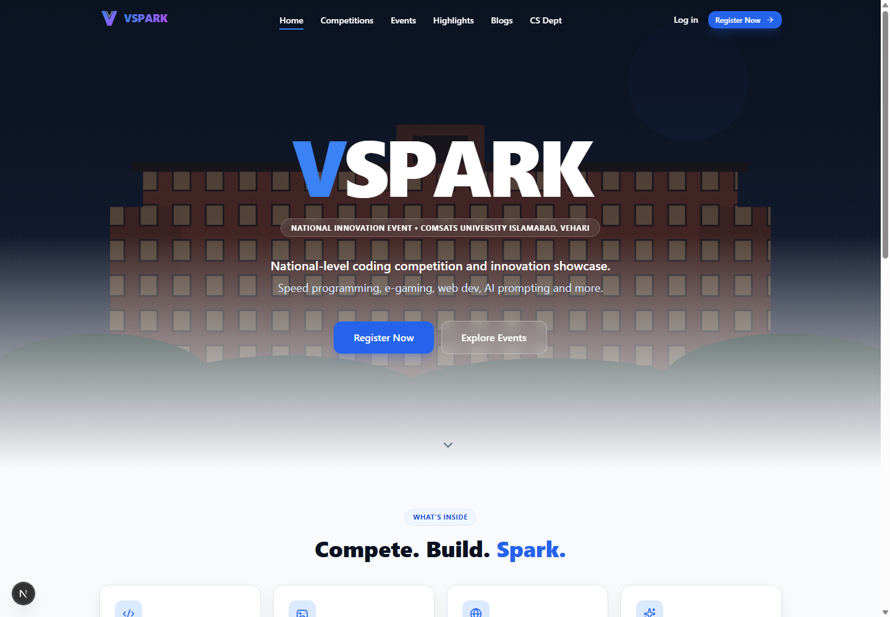
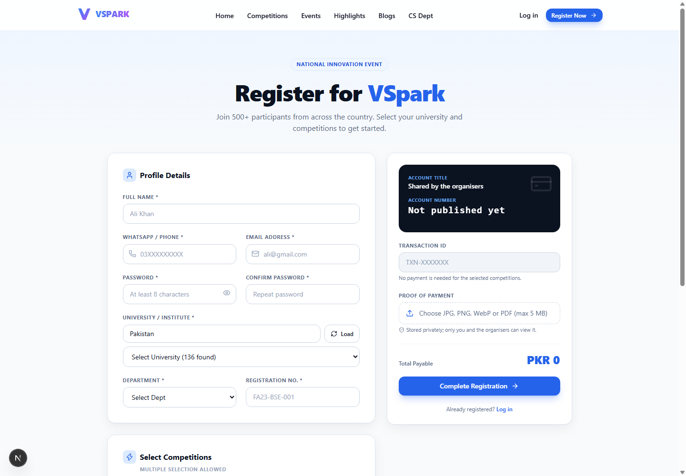
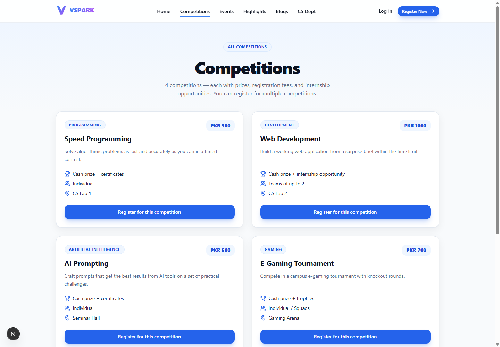
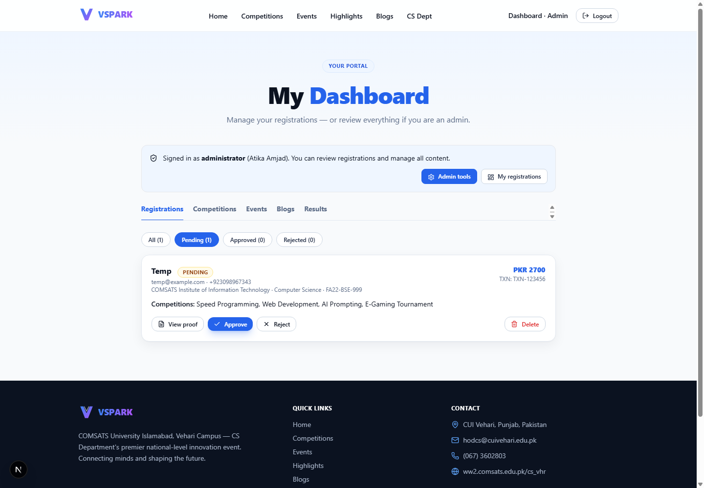

# VSpark — Web Development Competition Project

An independent, full-stack web application inspired by the VSpark reference site
(<https://vspark-omega.vercel.app/>): the national-level coding competition and innovation showcase of
COMSATS University Islamabad, Vehari Campus.

| | |
|---|---|
| **Student name** | Atika Amjad |
| **Registration number** | _your reg. no._ |
| **GitHub repository** | _https://github.com/…_ |
| **Live URL (Vercel)** | _https://….vercel.app_ |
| **Google Drive folder** | _link / location_ |

---

## 1. Official requirements vs. my implementation decisions

**Official (from the competition PDF):** responsive UI; authentication (register, login, logout, protected
routes); a real database with full CRUD; cloud storage for uploads with secure retrieval; at least one real
external API with error handling; public deployment (Vercel preferred); GitHub + Google Drive submission with
identical code; README with setup, technologies, integrations, deployment and screenshots; no secrets or `.env`
files in the repository.

The PDF allows *"an approved alternative"* for authentication and *"or an approved alternative"* for storage.
This project uses **Supabase** for all three: **Supabase Auth** (email + password), **Supabase Postgres**
(database) and **Supabase Storage** (private bucket for payment proofs). One hosted service covers
authentication, database and storage, and it has a genuinely free tier with no billing account required.

The following are **my own decisions**, based on the reference screenshots, and were not specified by the teacher:

- Registrations are **pending until an admin approves them** (the reference login page says credentials are issued after admin approval).
- Pending users **can log in** (so they can edit or cancel their pending registration) but cannot add new registrations until approved.
- Admin accounts are defined by a row in the `admins` table.
- Competitions, events, blogs and results are stored in Postgres and managed from `/admin`.
- A `/universities` page was added to display the external API data.
- The gallery uses local illustrations, and the Department page uses the static text in `src/data/content.ts`.
- The payment account details shown on the form come from optional env variables.

## 2. Features

- **Pages:** Home, Login, Register, Competitions, Events, Highlights (gallery + results tabs), Blogs (All / Achievements / Blog Posts + detail page), CS Department (Faculty / Programs / Achievements tabs), Universities, participant Dashboard, Admin dashboard.
- **Authentication:** Supabase email/password sign-up, login, logout, persistent sessions, protected routes (`/dashboard`, `/admin`), admin authorisation.
- **Database CRUD (Postgres):** registrations — create, read, update, delete (participant and admin); admin CRUD for competitions, events, blogs and results.
- **Cloud storage (Supabase Storage):** payment proofs are uploaded through a server route that verifies the Supabase access token, validates type/size/file signature, and stores the file in a **private** bucket. Files are retrieved through short-lived signed URLs, only for the owner or an admin.
- **External API:** Hipo Labs Universities API (`universities.hipolabs.com`) via a server route, with loading, empty and error states and a manual-entry fallback.
- **UX:** responsive navigation, loading indicators, empty states, toast notifications, form validation (zod) with field-level errors.

## 3. Technologies

Next.js 15 (App Router) · React 19 · TypeScript · Tailwind CSS 3 · **Supabase Auth** · **Supabase Postgres (Row Level Security)** · **Supabase Storage** · zod · lucide-react · Vercel · Git/GitHub.

## 4. Project structure

```
src/
  app/                    routes (App Router)
    api/upload            POST   verify Supabase token -> validate -> upload to Storage
    api/proof             GET    signed URL (owner/admin)   DELETE  remove file (owner/admin)
    api/universities      GET    proxy to Hipo Labs API (validation, timeout, error handling)
    dashboard/…           participant area (list, new, edit registration)
    admin/                admin area (registrations + content CRUD)
    login, register, competitions, events, highlights, blogs, department, universities
  components/             Navbar, Footer, RegistrationForm, CrudManager, AdminRegistrations, AuthGuard, …
  lib/                    supabase (client), supabaseServer (server + token check), db (data helpers),
                          useCollection, validation, auth context, API helpers
  data/content.ts         static gallery / department content
supabase/
  schema.sql              tables, RLS policies and the private storage bucket
  apply.sql               the same schema plus the legacy-rename migration
scripts/                  seed.mjs, make-admin.mjs
tests/                    validation tests
.env.example              required environment variable names (no values)
```

## 5. Setup (Windows / PowerShell)

Requirements: Node.js 20+ and npm.

```powershell
npm install
copy .env.example .env.local      # then fill in the values (see 5.2)
npm run dev                       # http://localhost:3000
```

### 5.1 Supabase

1. <https://supabase.com/dashboard> → **New project** (free plan, no card).
2. Open **SQL Editor → New query**, paste all of [`supabase/schema.sql`](supabase/schema.sql) and **Run**.
   This creates every table, all Row Level Security policies, and the private `payment-proofs` bucket.
3. **Project Settings → API** → copy the **Project URL**, the **publishable (anon)** key and the **secret
   (service_role)** key.
4. **Authentication → Providers → Email** → keep *Email/Password* enabled and **turn off "Confirm email"**
   so newly registered participants get a session immediately (the app checks for this and shows a clear error).
5. If the project previously contained another schema, also run
   [`supabase/fix-auth-trigger.sql`](supabase/fix-auth-trigger.sql) to remove any leftover signup trigger.

### 5.2 Environment variables

| Variable | Scope | Purpose |
|---|---|---|
| `NEXT_PUBLIC_SUPABASE_URL` | public | Supabase project URL used in the browser |
| `NEXT_PUBLIC_SUPABASE_ANON_KEY` | public | Publishable key (safe to expose; RLS protects the data) |
| `SUPABASE_URL` | server | Same URL, used by server routes and scripts |
| `SUPABASE_SECRET_KEY` | **server only** | Secret key — bypasses RLS. Never prefix with `NEXT_PUBLIC_` |
| `SUPABASE_BUCKET` | server | Storage bucket name (default `payment-proofs`) |
| `NEXT_PUBLIC_PAYMENT_ACCOUNT_TITLE`, `…_NUMBER`, `…_BANK` | public, optional | Payment details shown on the form |

### 5.3 First admin and sample content

```powershell
# 1) Register a normal account through the website (/register), then:
npm run make-admin -- your-email@example.com      # inserts a row in the admins table
# 2) Optional starter competitions / events / blogs (edit scripts/seed.mjs first):
npm run seed
```
Log in with the admin account and open `/admin` to approve registrations and manage content.

### 5.4 Commands

```powershell
npm run dev         # development
npm run build       # production build
npm start           # run the production build
npm run lint        # ESLint
npm run typecheck   # TypeScript
npm test            # validation tests
```

## 6. Deployment (Vercel)

1. Push the project to GitHub (see below).
2. <https://vercel.com> → **Add New → Project** → import the repository (framework: Next.js, no build overrides).
3. **Settings → Environment Variables** → add every variable from section 5.2 for Production (and Preview).
4. **Deploy**, then test register → login → upload → admin approval on the live URL.

```powershell
git init
git add .
git status                       # confirm no .env / .env.local is listed
git commit -m "VSpark competition project"
git branch -M main
git remote add origin https://github.com/<user>/<repo>.git
git push -u origin main
```

## 7. Security notes

- Secrets live only in environment variables; `.env*` (except `.env.example`) is git-ignored.
- The Supabase secret key is only imported by server code (`import "server-only"`).
- Upload route: requires a valid Supabase access token, ≤ 5 MB, JPG/PNG/WebP/PDF only, **file signature is checked against the declared type**, storage path is generated server-side (`<uid>/<timestamp>-<uuid>.<ext>`).
- Retrieval: `GET /api/proof` returns a 2-minute signed URL only to the file owner or an admin.
- **Row Level Security** enforces the same rules database-side: participants can only read/modify their own registrations and only while pending; nobody can self-approve or grant themselves admin; only admins can approve, change content or delete others' data.
- Route protection on the client (`AuthGuard`) is a UX layer; real enforcement is by RLS and server token checks.
- Known limitation: the fee total is computed in the browser and verified by the admin during payment review; the policies do not recompute it. No rate limiting is implemented on the API routes.

## 8. External API: Hipo Labs Universities

`GET /api/universities?country=Pakistan&name=…` calls `http://universities.hipolabs.com/search` from the server
(the API is HTTP-only, so browsers on an HTTPS site cannot call it directly). The route validates the query, applies a 10 s timeout,
normalises the fields, caches for one hour and returns a clear error (`502`) if the service is unavailable.
The UI shows loading, empty and error states and lets the participant type their university manually when the API fails.

## 9. Screenshots

Full list and status in [`docs/screenshots/README.md`](docs/screenshots/README.md). These were captured from the
running app against the live Supabase database:







## 10. Testing status

Verified locally: production build, TypeScript, ESLint, page rendering for all 11 routes, API error paths
(401 without a token, 400 on invalid input, 502 when upstream is unreachable), the validation schemas
(`npm test`), the seed and make-admin scripts, and the database policies — sign-up, own-registration insert,
profile insert, blocked self-approval, blocked self-promotion, cross-user isolation, admin read-all, admin
approval and admin content writes.
**Not tested in the build environment:** live Vercel deployment, and the Hipo Labs API from Vercel's network.
Run through the checklist in sections 5/6 on your configured project and capture the screenshots.
